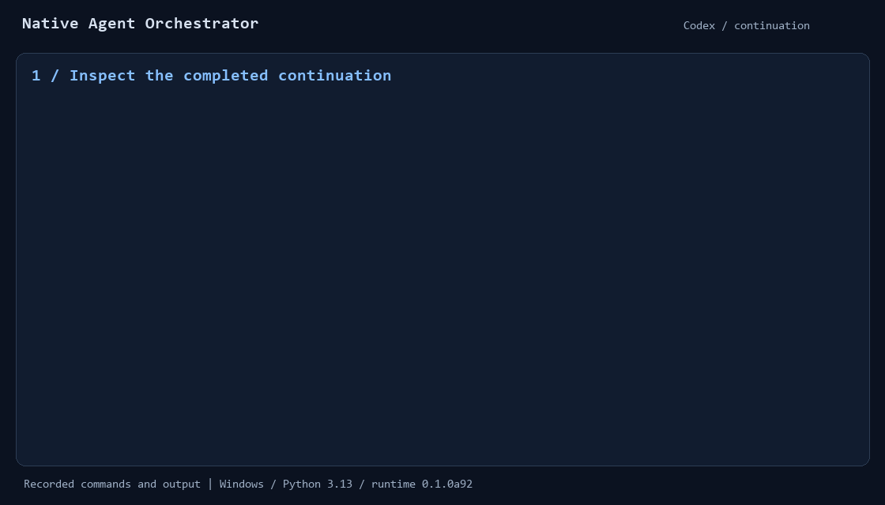
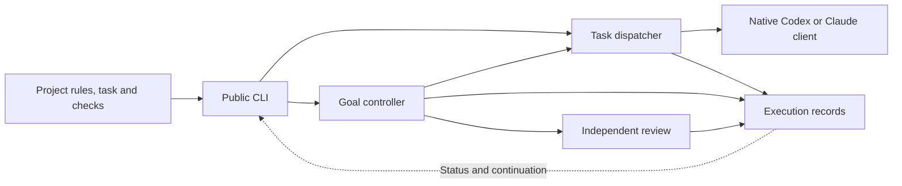

# Native Agent Orchestrator

[](https://github.com/tao19911024-gif/native-agent-orchestrator/actions/workflows/ci.yml)

Native Agent Orchestrator runs development tasks through native Codex and Claude
Code clients, retains their execution records, and continues work in the recorded
session. It combines project-defined checks with task dispatch, implementation,
independent review, and recovery.

## Use cases

- **Continue work across invocations.** Retain the task, interpreter, provider
  session, instructions, and execution evidence for the next invocation.
- **Implement and review a change.** Run a task through coding and independent
  review, with a committed candidate and review results.
- **Use one runtime across Git projects.** Register each project's workspace,
  rules, preflight command, and evidence directory in a project descriptor.
- **Inspect long-running work.** Read task status, execution logs, result
  receipts, and usage through the same CLI.

Projects supply requirements, tests, and acceptance criteria. The runtime manages
execution and session custody. Native clients supply model access and provider
authentication.

## Demonstration



The 24-second [terminal demonstration](docs/SHOWCASE.md) inspects a completed
Codex continuation, the resulting code change, and four passing tests.
The [runtime development case](docs/case-studies/CONTINUATION_RECOVERY.md)
explains a recovery-routing correction with reproducible regression coverage.

## Architecture



See [architecture and lifecycle](docs/ARCHITECTURE.md) for ownership and record
relationships.

## Install and run the example

Use Windows, Python 3.13 or newer, Git, and PowerShell:

```powershell
git clone https://github.com/tao19911024-gif/native-agent-orchestrator.git
cd native-agent-orchestrator
python -m venv .venv
& .\.venv\Scripts\python.exe -m pip install '.[test]'
$RuntimePython = (Resolve-Path .\.venv\Scripts\python.exe).Path
$ExampleRoot = Join-Path (Split-Path $PWD.Path -Parent) 'nao-example'
& $RuntimePython .\examples\quickstart.py $ExampleRoot
```

The example creates a separate Git project, runs its baseline test, and inspects
the generated configuration. Choose a new directory for `$ExampleRoot`.

Continue with one of these workflows:

| Workflow | Guide |
| --- | --- |
| Execute a task in the project just created | [Greeting task execution](examples/README.md#2-execute-the-task-with-codex) |
| Stop at a checkpoint and continue the same session | [Session continuation](examples/CONTINUATION.md) |
| Implement, commit, and independently review a task | [Coding and review with Codex and Claude](examples/REVIEW.md) |
| Inspect recorded execution results | [Demonstration results](docs/DEMO.md) |

Model-backed execution uses a separately installed and authenticated native
client and that account's allowance. Installation, project registration, and
configuration inspection run locally. See [installation and project setup](docs/GETTING_STARTED.md)
for source and wheel installation, and [operating environment](docs/LIMITATIONS.md)
for platform and execution settings.

## Package and command names

| Name | Purpose |
| --- | --- |
| Native Agent Orchestrator | Project and repository name |
| `foundry-runtime` | Python distribution installed by pip |
| `foundry_runtime` | Python import and module entry point |
| `foundry` | Main CLI; equivalent to `python -m foundry_runtime` |
| `foundry-recovery` | Recovery-record CLI; equivalent to `python -m foundry_runtime.recovery` |

## Documentation

- [Project setup](docs/GETTING_STARTED.md)
- [Project showcase](docs/SHOWCASE.md)
- [Configuration reference](docs/CONFIGURATION.md)
- [Command reference](docs/CLI.md)
- [Delivery baseline and record associations](docs/DELIVERY_BASELINE.md)
- [Review feedback and correction](docs/FEEDBACK_LOOP.md)
- [Continuation and recovery](docs/RECOVERY.md)
- [Troubleshooting](docs/TROUBLESHOOTING.md)
- [Architecture and lifecycle](docs/ARCHITECTURE.md)
- [Operating environment](docs/LIMITATIONS.md)
- [Release history](CHANGELOG.md) and [downloads](https://github.com/tao19911024-gif/native-agent-orchestrator/releases)

## Contributing and support

Report problems and propose changes through [GitHub Issues](https://github.com/tao19911024-gif/native-agent-orchestrator/issues).
Include reproduction commands, the observed result, and relevant test output.
Follow the [contribution guide](CONTRIBUTING.md) for development and verification.

## License

Source code and documentation are distributed under the [MIT license](LICENSE).
Dependency and native-client notices are listed in [THIRD_PARTY_NOTICES.md](THIRD_PARTY_NOTICES.md).
